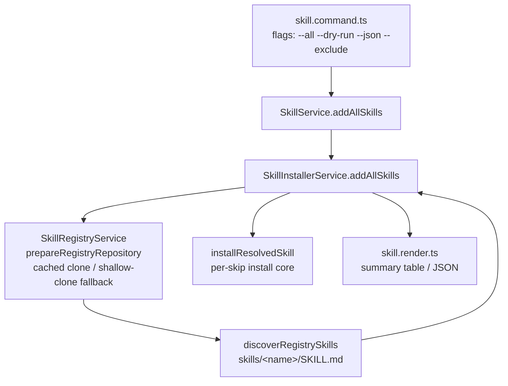

# System Design & Architecture

## Architecture Overview



- Enumeration flows through `prepareInstallableRegistry` (merged registry → cached clone with pull/shallow-clone fallback, or live `file://` root) and `discoverRegistrySkills`. This honors the "registry itself is the stable contract" requirement — the search index and raw cache-path scanning are never used.
- Installation reuses the single-skill core (`installResolvedSkill`), which already implements idempotent skip semantics per target (existing dir → `action: "skipped"`), so no new install logic is introduced.

## Data Models

```ts
interface AddAllSkillOptions extends AddSkillOptions {
  exclude?: string;   // glob
  dryRun?: boolean;
}

type AddAllSkillItemStatus = "installed" | "skipped" | "failed";

interface AddAllSkillItem {
  skill: string;                  // matches issue: {skill, status, error?}
  status: AddAllSkillItemStatus;
  error?: string;
}

interface AddAllSkillsResult {
  registryId: string;
  dryRun: boolean;
  total: number;                  // installable skills considered (after exclude)
  installed: number;
  skipped: number;
  failed: number;
  items: AddAllSkillItem[];
}
```

- `skipped` in bulk mode means "already installed, counted, untouched" (per-item targets stay internal); `failed` carries `error` per skill.
- `--json` prints `JSON.stringify(result, null, 2)` via `ui.text`, mirroring `renderStatusReport`'s `--json` convention.

## API / CLI Design

```
ai-devkit skill add <registry> --all [-g -e env...] [--mode copy] [--dry-run] [--json] [--exclude <glob>]
```

1. `--all` + positional `skill-name` → hard error before any work (unit-tested).
2. `--dry-run`: enumerate + filter, mark everything that is not already installed as `installed`-would-happen in the listing (status `"installed"` under a `dryRun: true` result) but touch nothing. Existing installs show `skipped`. No config writes.
3. Interactivity guard: single `confirm()` prompt only when `isInteractiveTerminal()` AND installable-skill count > 20 (after exclude); declining cancels cleanly (exit 0, nothing installed). Non-TTY never prompts. This guard runs before environment resolution prompts are irrelevant — note `resolveSkillInstallOptions` already enforces non-TTY constraints for missing envs, unchanged.
4. `--built-in` code path untouched (UX unchanged); it may later adopt the shared summary renderer but that is not required.

## Component Breakdown

- `packages/cli/src/commands/skill/skill.command.ts` — new options, exclusivity check, confirm guard, dry-run/json/exclude wiring, `process.exitCode = 1` when `failed > 0`.
- `packages/cli/src/services/skill/skill.service.ts` — thin `addAllSkills` passthrough.
- `packages/cli/src/services/skill/installer/skill-installer.service.ts` — `addAllSkills`: prepare registry → discover → exclude-filter (`picomatch`-style glob via `minimatch`, already a dependency? verify; else hand-rolled translation) → loop `installResolvedSkill` with per-skill try/catch → aggregate.
- `packages/cli/src/services/skill/skill.types.ts` — result types.
- `packages/cli/src/commands/skill/skill.render.ts` — `renderSkillAddAllResult` (summary table installed/skipped/failed + per-skill lines) and JSON path.
- Unit tests: `packages/cli/src/__tests__/commands/skill.test.ts` (command semantics) + installer-level tests via existing service test harness.
- E2E: `e2e/skill-add-all.e2e.ts` with a `file://` fixture of 3 skills.

## Design Decisions

- **Reuse `addSkills` loop vs new orchestrator**: `addAllSkills` reuses `installResolvedSkill` per skill but wraps each call in try/catch because `addSkills` fails fast; bulk mode must continue on per-skill failure and still count skips.
- **Idempotency definition**: a skill is "skipped" when its install produced no new target (existing dirs). `installResolvedSkill` already reports this via item actions; bulk mode derives per-skill status: any `failed` throw → failed; all targets skipped/conflict → skipped; otherwise installed.
- **Glob**: `--exclude` matches against skill names using `minimatch` if present in the dependency tree, otherwise a small translator (`*` → `*`, `?`, `[...]` handled by `RegExp`). Prefer existing dependency to avoid new deps — check `package.json`.
- **Confirm threshold 20**: from the issue verbatim ("TTY + registry containing >20 skills asks one confirm"); counted after `--exclude` filtering since that is the actual install set.
- **Exit code**: `process.exitCode = 1` (not `process.exit`) when any skill failed, after rendering the summary, so stdout flushes normally — consistent with the issue's "non-zero exit if any failed".

## Non-Functional Requirements

- Performance: sequential per-skill install matches existing behavior; registries are local after cache warm.
- Safety: dry-run performs zero filesystem mutations and zero config writes; confirmation guards mass changes on large registries.
