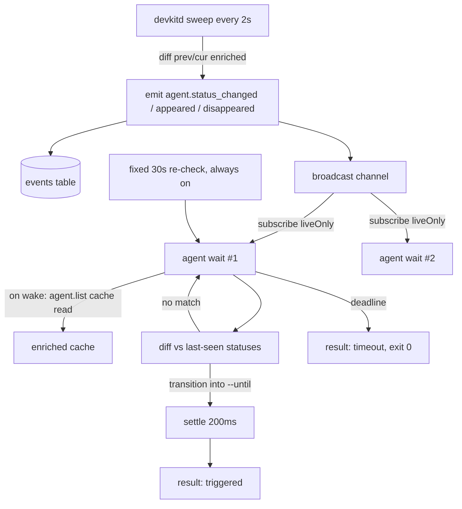

# System Design & Architecture

## Architecture Overview



- **devkitd (Rust):** the sweep already diffs process snapshots to emit `agent.appeared` and `agent.disappeared`. It will also compare the previous and current enriched rows and emit `agent.status_changed` for every `(pid, sessionId)` whose `status` changed.
- **CLI `agent wait` (TS):** subscribes to the daemon's live events and treats any `agent.*` event as a wake-up. On wake it reads the canonical agent list (the same `AgentInfo` view as `agent list`, built from the daemon cache) and diffs it against the statuses it last saw. Events only signal that something changed. The decision always comes from the list, so names, overlays and status match `agent list` exactly.
- **Safety re-check:** a fixed 30s internal re-check always runs. Daemon events only make the wait react sooner. This one mechanism covers the no-daemon case, a dropped subscription, and an older daemon that doesn't emit `agent.status_changed` yet.

## Data Models

**Daemon event `agent.status_changed`**

```json
{ "pid": 123, "sessionId": "…", "from": "running", "to": "waiting", "agent": { /* EnrichedAgent */ } }
```

- Emitted after the `disappeared`/`appeared` events in the same sweep.
- Rows are matched by `(pid, session_id)`. Rows absent from either side are lifecycle events, not status changes.

**CLI internal: last-seen map** `key = "<type>:<pid>"` maps to `{ agent: AgentInfo, status }`. It starts from the baseline and is updated after every check, so a quick `running → waiting → running` still fires if any check observes `waiting`.

**CLI result (`--json`)**

```json
{
  "reason": "triggered" | "timeout",
  "elapsedMs": 183000,
  "changes": [
    { "name": "api-worker", "type": "claude", "pid": 123, "from": "running", "to": "waiting" },
    { "name": "ui-worker",  "type": "codex",  "pid": 456, "from": "running", "to": "exited" },
    { "name": "new-one",    "type": "claude", "pid": 789, "from": null,      "to": "appeared" }
  ]
}
```

## API Design

```
ai-devkit agent wait [--id <name>]... [--group <group>]
                     [--until waiting,idle,exited,appeared]
                     [--timeout <ms>] [--json] [--debug]
```

| Option | Default | Notes |
|---|---|---|
| `--id` | none (all live agents) | Repeatable. Each identifier must resolve to exactly one agent via `manager.resolveAgent`, otherwise the command errors |
| `--group` | none | Members resolve the same way as `--id`. Can't be combined with `--id` |
| `--until` | `waiting,idle,exited` | Comma-separated. `appeared` only takes effect without `--id`/`--group` |
| `--timeout` | `540000` | Parsed with `parseMilliseconds` |
| `--json` | off | Prints the result object |

Exit codes: `0` for `triggered` and `timeout`. Non-zero, through `withErrorHandler`, for invalid options, unknown groups, or unresolved/ambiguous ids.

Text output:

```
api-worker (claude, pid 123): running → waiting
ui-worker (codex, pid 456): running → exited
```

On timeout it prints `No matching agent changes within 540000ms.`

## Component Breakdown

| Component | File | Responsibility |
|---|---|---|
| Status diff | `rust/crates/devkitd/src/server.rs` (`status_changes` fn + `apply_sweep`) | Pure diff of prev/cur enriched rows, then emit `agent.status_changed` |
| Wait service | `packages/cli/src/services/agent/agent-wait.service.ts` | `parseWaitUntil`, `diffAgentChanges` (pure), `waitForAgentChanges` (loop over an injected `AgentWaitSource` and clock) |
| Wait command | `packages/cli/src/commands/agent/wait.command.ts` | Option parsing, target resolution, builds the daemon-backed or local `AgentWaitSource`, renders output |
| Registration | `packages/cli/src/commands/agent/agent.command.ts` | `registerAgentWaitCommand` |
| Skill | `skills/agent-orchestration/SKILL.md` | Loop step 5 uses `agent wait` |

**`AgentWaitSource`** (injected so the loop is testable without a daemon):

```ts
interface AgentWaitSource {
  list(): Promise<AgentInfo[]>;
  /** Best-effort live wake-ups; a no-op when there is no daemon. */
  subscribe(onWake: () => void): Promise<void>;
  close(): void;
}
```

- **Daemon source:** `ensureDaemon()`, then `client.subscribe(..., { liveOnly: true })`, which wakes on any `agent.*` event. `list()` is `manager.listAgents({ enriched: await client.listAgents() })`, and falls back to `enriched: null` (local detection) if the RPC fails, for example after a disconnect.
- **Local source:** `subscribe` does nothing and `list()` is `manager.listAgents({ enriched: null })`.

**Loop (`waitForAgentChanges`):**

1. `subscribe` first, then take the baseline with `list()`, so no event is lost between the two.
2. Run a check on every wake-up and on the fixed 30s re-check. Wake-ups that arrive during a check are combined into one follow-up check.
3. A check runs `list()`, filters to the watched keys (or everything when unfiltered), and calls `diffAgentChanges(lastSeen, current, until)`, then updates `lastSeen`.
4. On the first match it records the changes and keeps checking for up to the settle window (200ms, never past the deadline), adding further changes and de-duplicating by key so the latest one wins. Then it returns `triggered`.
5. At the deadline it returns `timeout`. It always calls `close()` and clears its timers.

**`diffAgentChanges` rules:**

- The key is present in both lists and the status changed into a target state: emit `{from, to: status}`.
- The key is in last-seen but missing from the current list, and `exited` is in `until`: emit `to: "exited"`.
- The key is new, `appeared` is in `until`, and the wait is unfiltered: emit `from: null, to: "appeared"`.
- Already being in a target state without a transition produces no change.

## Design Decisions

- **Events are wake-ups; the list decides.** Using the event payloads directly would skip the TS overlay (registry names, pins, the empty-answer cross-check) and could disagree with `agent list`. Re-reading the cached list costs one cheap socket call.
- **Fire only on changes, compared with last-seen statuses rather than the start-time baseline.** If an agent was already waiting, firing would make every wait return immediately. Comparing with the most recent check also catches waiting → running → waiting cycles.
- **Status diff in the daemon, not in each client.** One sweep serves every waiter, which answers the question of many concurrent waits.
- **Resolve targets once at start.** This keeps `--id` semantics identical to `agent send` and avoids re-matching ambiguity mid-wait. As a result `appeared` doesn't apply to filtered waits.
- **No `--interval` flag.** It would only matter for the rare no-daemon fallback, so a fixed 30s constant is enough.
- **Exit 0 on timeout.** A timeout is the normal outcome of a loop iteration, and some harnesses treat a non-zero exit as a tool failure.
- **Alternatives considered:** polling `agent list` in each waiter (N× cost, slower to react); emitting status events from TS (status is already computed in the Rust sweep); harness-specific scheduling (not portable).

## Non-Functional Requirements

- **Latency:** at most one sweep (2s) plus the settle window (200ms) after a change, about 1s typical. The settle window was first 2s; it was cut because one check already sees every change from a sweep, so a long window only merged changes from consecutive sweeps, and the orchestrator's next scan catches those anyway.
- **Cost:** with the daemon, each wake-up is one `agent.list` read from the cache, plus one read per 30s re-check. N concurrent waits cost N small reads per event. No waiter scans processes itself unless the daemon is absent.
- **Reliability:** the always-on 30s re-check means missed events, a dropped connection, or an older daemon only delay detection, never block it.
- **Storage:** each status change adds one event row, and existing `EVENT_RETENTION` pruning applies.
- **Security:** no new surface. It uses the existing same-uid daemon socket.
