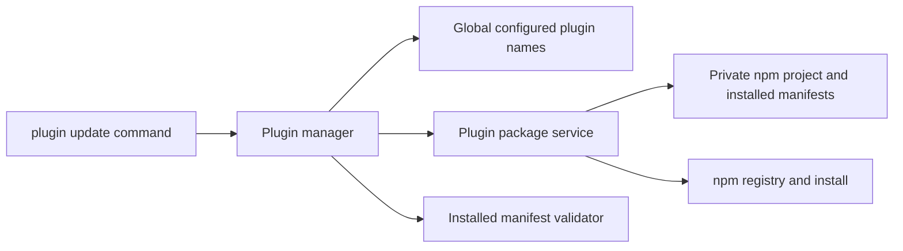

# Plugin update design

## Architecture Overview

## Data Models

`PluginUpdateResult` contains `name`, `status` (`updated`, `up-to-date`, `failed`), optional `fromVersion`, `targetVersion`, `toVersion`, and `error`. Updated/up-to-date results have known from/to versions; failed results retain whatever metadata was successfully read. `targetVersion` is the registry pre-check value; `toVersion` is only populated from an observed installed version (or the unchanged version for equality). Unknown values render as `unknown`.

The manager returns `PluginUpdateResult[]`. CLI derives summary counts from statuses and major indicators from version pairs. Do not persist results, duplicate counts, or synchronize a separate major-crossing boolean. No config schema changes.

## API Design

Command: `plugin update [package]`; manager method: `update(pluginName?: string): Promise<PluginUpdateResult[]>`.

Extend `PluginPackageService` with:

- `getInstalledVersion(pluginName: string): Promise<string>`: validate package name, read `<npm-root>/node_modules/<package>/package.json` directly, and validate its version. No project initialization or mutation during lookup.
- `getLatestVersion(pluginName: string): Promise<string>`: validate package name, run `npm view <package>@latest version --json`, parse a JSON string, and validate the version. Run from the existing npm project after the installed-version read succeeds.
- `installLatest(pluginName: string): Promise<void>`: install `<package>@latest` in the private npm project, retaining the existing bare-name validator for user input. Keep existing `install` behavior unchanged for add.

Extend injected `NpmRunner` return type to `Promise<string | void>`; the default execFile runner returns stdout. Existing void-returning mutation mocks remain compatible. Version lookup rejects absent/non-string/malformed output rather than installing speculatively. Use a local shared version validator for canonical numeric major.minor.patch plus optional SemVer prerelease/build identifiers; reject leading-zero numeric core/prerelease identifiers. No range resolution or ordering is needed: equality compares validated version strings, and major indication compares numeric major components.

Manager validates a supplied target before selection, reads configured names once, and rejects unconfigured targets before npm calls. For each selected name: read previous version, query latest, return up-to-date on equality; otherwise install latest, read actual installed version, validate installed manifest, and return updated. Read the actual version before manifest validation so validation failures can still report it. Catch each plugin failure with retained metadata, continue sequentially, and never call config mutations or rollback. A failure to read the configured plugin list remains a command-level error.

## Component Breakdown

Command uses existing `ui.table` for package/status/version/notes and `ui.summary` for the three counts. Successful rows show `from → to`; append `MAJOR` when numeric major components differ. Failed rows show `from → unknown` unless an actual resulting version was read, and include a separately labeled attempted target when known. Flag known major crossings on observed version pairs; an attempted major target is explicitly labeled as attempted. Failure details include `Previously installed: <version or unknown>` and explain that installation may have changed and manual recovery is required; no generated recovery command or automatic restoration. Empty arrays render the existing no-global-plugins warning. Set `process.exitCode = 1` after rendering any failed result, allowing all results to print. Manager owns selection, sequential processing, pre-check, validation, and per-plugin failure capture. Package service owns filesystem/npm interactions. Global config remains read-only during updates.

## Design Decisions

Optional target follows skill update UX. Three-state reporting avoids claiming unchanged installations updated. Explicit latest includes majors as approved. Preserve the previous version in memory for manual recovery. Do not reuse add's uninstall rollback. Read actual resulting version to avoid claiming the pre-check target was installed if the registry tag moved.

## Non-Functional Requirements

One registry version query per selected plugin and local installed-version reads; no separate outdated scan. Sequential installs avoid concurrent mutations of the shared npm project. Use execFile argument arrays and package-name validation. Tests isolate filesystem and npm operations. No new abstractions without a current caller.

## Design Review — 2026-11-14

Coverage: optional selection maps to manager validation/config reads; latest and three states map to version pre-check and installLatest; deltas/major flags map to observed result metadata and CLI rendering; manual recovery maps to retained fromVersion and explicit failure notes; config preservation and bulk continuation map to manager control flow. All requirements have design coverage.

Alternatives reviewed: a separate read-only npm-query runner preserves the existing runner type but adds another injection surface for the same subprocess; returning optional stdout is smaller and retains existing mutation mocks. Returning a summary object duplicates data already available in results; deriving counts in the sole CLI consumer is simpler. A new version library adds dependency surface for a validator/equality/major extraction need; keep the local validator scoped and test its boundaries.

Known limits: no lock against another CLI process updating the shared npm project; no automatic recovery after partial npm changes; latest can move between lookup and install. These do not change the approved recovery/race contract. No unresolved design decisions. Next: phase 4 planning review before TDD implementation.
