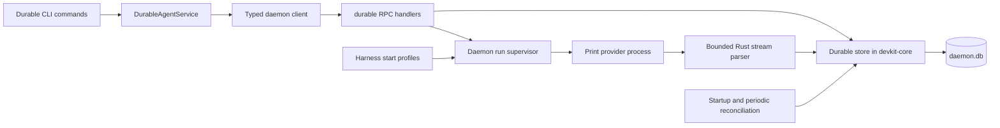

# Durable agents managed by devkitd

Status: approved on 2026-11-17; Decision #3 was subsequently simplified on 2026-11-24 to a daemon-only model (no legacy `agents.db` import, ownership fence file, or local TS fallback). Issue #414 defines scope.

## Architecture Overview

The daemon owns process launch, run ownership, parsing, and completion. The durable store owns all state transitions. Discovery may observe provider processes, but disappearance from the interactive-agent discovery set is not sufficient evidence that a durable process died. Reconciliation verifies the recorded process identity directly. Durable rows remain separate from transient registry rows and their pruning.

## Approved Design Decisions

### 1. Spawn/parse split: recommend option (a), minimal Rust extraction

Port the observable contracts of the three TS parsers, not a general provider transcript system. Claude requires its matching session and single terminal result; Codex requires thread identity, completed turn, and assistant result; Pi requires matching session, agent completion, and assistant text. Preserve malformed/oversized/incomplete stream rejection and session-mismatch errors. Exit zero is necessary but insufficient for success. Retain the current line-size limit and 4096-character stored summary limit; avoid accumulating unbounded messages or stderr.

This duplicates a small protocol implementation during the compatibility window, requiring fixture parity tests, but gives devkitd independent operation after the CLI disconnects. Option (b), a TS parsing worker, reuses parsers but adds Node/package-version coupling, worker supervision, and another recovery boundary. Option (c), TS spawning, has the smallest immediate port but does not meet the issue's daemon-spawn requirement and ties lifecycle ownership to callers.

### 2. Restart: recommend identity-based adoption, with explicit result limits

On startup, retain a running run if the provider PID and process start identity match. PID alone never establishes ownership. For imported TS runs, also respect a matching live TS owner while it may still be spawning the provider; do not relaunch that run. Dead or reused identities become interrupted, degraded, and session-health unknown unless a trustworthy completion was already committed. A failed process-discovery probe leaves state unchanged and retries.

For children of the current daemon, the supervisor waits/reaps and commits the actual exit code plus protocol outcome. The sweep must not race that waiter into recording an interruption. After daemon restart, adoption means monitoring and preventing concurrent sends; the restarted daemon cannot reattach old stdout pipes or wait for an orphan's exit code. When an adopted process disappears without a committed outcome, record interrupted with null exit code, never infer success from disappearance or a terminal stream event alone. Fully recovering successful results across daemon death would require a persistent supervisor/completion journal and is deferred.

### 3. Ownership: daemon-only (no legacy import or local fallback)

Because durable mode has minimal pre-existing adoption, `devkitd` is the sole authority for durable agents in `daemon.db` — with no legacy `agents.db` import, no `durable_metadata` import marker, no `durable-owner-v1.json` fence file, and no local TS fallback in the CLI. Users recreate any pre-devkitd durable identities with `ai-devkit agent start --mode durable`.

Mixed interactive/durable read commands (`agent list`, `agent detail`, `agent sessions`, `agent session detail`) gracefully skip durable lookup when `devkitd` is unavailable or predates `durable.*` RPCs so interactive workflows (including `AI_DEVKIT_NO_DAEMON=1`) continue uninterrupted. Explicit durable mutations (`create`, `send`) require a running, compatible `devkitd` and return an actionable error otherwise. The existing interactive registry bridge in `agents.db` remains separate and untouched.

## Data Models

Add durable tables in `Store::open` (`devkit-core/src/store/durable.rs`):

- `durable_agents`: existing identity, unique name and provider-session constraints, provider/mode, canonical cwd, state, session health, timestamps, active run reference, and last result projection. Preserve wire fields of the TS DurableAgent model.
- `durable_runs`: stable run ID/token, agent foreign key, start/completion timestamps, owner/provider process identities, running or terminal status, nullable exit code, bounded result summary, and a full success result bounded by the parser line limit for foreground CLI output. Enforce at most one active run per agent.
- Run ownership and completion remain authoritative in the durable store; registry discovery never writes durable outcomes.

Acquire uses a short immediate transaction and compare-and-set guard. Commit acquisition before spawning; attach the spawned provider identity under the same token. Spawn failure completes the acquired run as failed. Completion, session binding, stop, and reconciliation require the current token, preventing a stale waiter from modifying a replacement run. Never hold the database lock while launching, parsing, waiting, or stopping processes.

Agent state remains ready/running/degraded; success returns ready, failure/interruption degraded. Session health follows existing provider service behavior. Codex alone can bind a provider session after creation, only under the active token; mismatched or duplicate bindings fail. Claude/Pi session UUIDs are generated at create. Cwd is canonicalized at create and revalidated before every run, including rejecting a changed symlink binding.

## API Design

Use the existing same-user socket, response error envelope, and generated TS protocol types. Proposed contracts:

| Method | Input | Result and behavior |
| --- | --- | --- |
| `durable.create` | name, provider, cwd | Persisted durable agent; no provider launch |
| `durable.list` | none | DurableAgent array with reconciled state |
| `durable.show` | reference | Exact ID first, else case-insensitive name; agent, ambiguity array, or null |
| `durable.run` | agent ID, prompt | Atomically acquire and launch; return agent plus run ID promptly |
| `durable.send` | agent ID, prompt | Same acquisition/launch semantics for a subsequent prompt; common internal operation |
| `durable.stop` | agent ID, optional expected run ID | Stop current identity-verified process; preserve agent/session; idle stop is idempotent |

`show` includes the active run and last result; the CLI can poll its returned run ID to retain foreground send behavior without a long socket request. The run survives a polling client disconnect. Final CLI output/errors preserve existing behavior. Polling must distinguish another run's result; retain completed run lookup by run ID in `show` rather than relying on the mutable last-result projection alone.

Stop marks cancellation under the run token, signals only the verified process/group, waits with a bounded grace period and escalates only against the still-matching identity. Finalize interrupted after exit; stop/completion races have one terminal winner. Expose busy, not found, invalid cwd, session mismatch, spawn/protocol failure, and ownership-change errors through typed daemon errors.

## Component Breakdown

- `devkit-core`: durable schema/store, atomic transitions, projections, process identity (`durable_process.rs`), protocol types; dedicated durable store module alongside registry storage.
- `devkit-harness`: per-provider durable launch profiles and bounded result extraction. First-run/resume argv mirrors current TS runners; invoke executable plus argv directly, write prompt to stdin, and discard stderr without retaining unlimited data.
- `devkitd`: durable RPC orchestration and child supervisor (`supervise_child` / `classify_run_outcome`); startup/2s sweep reconciliation; child waiters finish independently of sockets; non-blocking stop lock scoping and post-`SIGKILL` wait. Avoid blocking the async socket loop.
- `daemon-client`: typed durable methods and capability probing. Never retry a possibly executed mutation on transport or domain error.
- CLI (`DurableAgentService`): route durable start/send/list/detail/session/sessions through `devkitd`, preserving existing output, ambiguity handling, provider session lookup, `--debug` tracing, and canonicalized `--cwd` session filtering. Mixed reads skip durable lookup when `devkitd` is absent/outdated; mutations require a compatible `devkitd`.

## Non-Functional Requirements and Validation

Use deterministic stub providers through an injectable start-profile command resolver; no real provider APIs in tests or smoke. Fixture commands emit each actual provider protocol, deliberately fail, block for stop/restart tests, or emit malformed/mismatched output. Production launch profiles remain fixed harness data, without a new arbitrary-command RPC.

Validation after the ruling: TDD store transition/concurrency/token tests; Rust parser parity fixtures; spawn failure, actual exit status, stop/completion race, restart/PID reuse tests; migration retry/conflict and import preservation tests; capability/fallback ownership tests; CLI session output tests; repository-root durable E2E through the real daemon/socket/CLI with isolated storage and stub providers. TS unit/integration tests stay in package `tests/`; E2E stays in root `e2e/`. Run Rust tests, `npx nx test cli` with dependencies built, new E2E, lint/fmt, and a disposable smoke before review/rebase/PR. No commit or push until phases pass.

## Gate Status

Issue scope is covered. All three human rulings are approved; requirements and implementation may proceed under the standing gate protocol. Base and feature docs lint pass (12 feature checks). Task tracing probe failed with `unknown command 'task'`; continue without tracing. Existing supplied worktree is clean and on `feature-durable-devkitd`; dependency install was already completed per brief, and the root workspace build passes.
