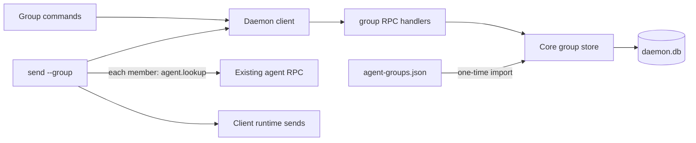

# Agent groups in daemon.db

Status: approved by the user on 2026-11-18. Requirements and planning follow
this approved design. Scope source: issue #413 and the supplied
group-daemon brief. Base: main commit 47ffc9ca; PR #456 is open and is not a dependency.

## Architecture Overview

The daemon is the sole owner and writer of group state. Extend the existing
Store, protocol types, dispatcher, and daemon client on main. Put group persistence
in a dedicated core store module and wire operations in the group RPC namespace.
Replace JSON access in CLI group commands with an asynchronous daemon-backed
service while retaining domain error classes and command output shapes.
Reuse connection/capability detection conventions, but never route groups back to
JSON when connection or capability detection fails. An older daemon requires an
upgrade/restart. Do not copy the agent registry's repeat-import/dual-write bridge.

## Design Decisions — approved 2026-11-18

1. **Membership rows.** Use `group_members(group_name, member, position)`
   with unique `(group_name, member)` and `(group_name, position)`, and a foreign key
   to groups with cascading deletion. Enable foreign key enforcement on the store
   connection. Order reads by position. Rows give explicit ordering and atomic
   membership operations; a JSON column is simpler to deserialize but requires
   rewriting and revalidating the whole array for every member operation.
2. **Unavailable when daemon is down.** All seven commands and group
   lookup require the daemon. A frozen JSON fallback would expose outdated
   membership and could target agents removed from a group. Transport failure and
   unsupported methods produce actionable errors, without local retries.
3. **Delete JSON after committed import.** The database ownership fence
   is authoritative. Keeping a frozen file invites stale reads and mistaken edits.
   Commit imported data and the fence before unlinking the source. Cleanup failure
   must not undo ownership or permit a second import; report it and retry cleanup
   on subsequent startup. Never delete a source whose import failed.

## Data Models

`groups`: name primary key, created_at and updated_at as preserved ISO timestamp
strings, plus an internal insertion ordinal to preserve existing list order.
`group_members`: group_name, member string, position integer; positions preserve
input order and may have gaps after removal. Members are identifiers, not foreign
keys to live agent registrations: missing/dead agents do not invalidate a group.
`group_migrations`: a namespaced one-time ownership marker, committed in the same
transaction as the imported groups and members. No dependency on a durable-agent
migration table from PR #456.

All mutations run under the existing Store connection mutex and a transaction.
Create, replace-members, add, remove-member, and delete enforce invariants before
commit. No-op add preserves updatedAt; successful membership changes update it.
Create/update reject duplicates after trimming; members must be nonblank but do
not inherit the group-name regex. Names use the existing AGENT_NAME_REGEX rules.
Removing an absent member is InvalidMember; removing the final member is
EmptyMembers. Preserve existing validation/error precedence where observable.

## API Design

Use the existing daemon wire envelope and typed Rust/TypeScript protocol types.
Group records retain `{name, members, createdAt, updatedAt}`.

| RPC | Parameters | Result |
| --- | --- | --- |
| group.create | name, members | group |
| group.update | name, members | group with replaced members |
| group.add | name, member | group |
| group.remove_agent | name, member | group |
| group.remove | name | deletion acknowledgement |
| group.list | none | groups in insertion order |
| group.detail | name | group |
| group.lookup | name | group with ordered members for fanout |

Use distinct coded errors for NotFound, Conflict, InvalidName, InvalidMember,
EmptyMembers, and Storage; map them back to existing CLI domain error categories.
Include the relevant group/member identifier in structured details. Malformed
wire parameter types remain invalid_params. Connection/capability errors remain
availability errors rather than masquerading as missing groups.

Group send first calls group.lookup, then uses agent.lookup for each resolved
member and the existing client runtime send machinery. Preserve ordered targeting,
per-member outcomes, and existing fanout behavior. The group path must not silently
use local registry targets if agent.lookup fails or is unsupported. Ordinary
single-agent send behavior remains outside this migration's scope.

## Import and Ownership

Before serving group RPCs, initialize the group schema and perform import using
the daemon's configured data-home conventions, including disposable-home support.
Check the database fence first. If owned, ignore any recreated JSON source.
Otherwise read version 1, validate the entire document, and atomically insert all
groups/members and the ownership marker. Preserve timestamps and ordering.
An absent source commits ownership of an empty initial state so a later stale
file cannot resurrect groups. Invalid JSON, unsupported versions, invalid domain
data, or duplicate group names fail the whole import without a fence or deletion;
surface Storage rather than silently losing rows. Group operations remain blocked
until repaired, while unrelated daemon operations can continue.

Never overwrite existing database groups on import conflict. A crash before
commit leaves the source available for retry; a crash after commit cannot repeat
the import. JSON deletion follows commit and is cleanup only. Concurrent writes
from old CLI versions during migration are unsupported; release guidance must
require stopping old writers before upgrade. Rollback to an old CLI does not
recover group state from JSON after successful migration.

## Validation and Rollout

- Core store tests: CRUD, ordering, normalization, duplicate rejection, no-op add,
  absent/final-member removal, timestamp behavior, atomic rollback, persistence,
  concurrent mutations, valid/malformed/absent import, crash boundaries and fence
  against recreated JSON and deleted-group resurrection.
- Daemon integration tests: all eight RPCs, malformed requests, error categories,
  restart/import behavior, cleanup failure and unsupported capability behavior.
- TypeScript tests in packages/<pkg>/tests/: daemon routing of seven commands,
  error mapping, availability behavior, group lookup and per-member agent lookup.
- E2E in root e2e/: built CLI and real daemon with disposable homes and registered
  stub entries or wire verification of fanout targets; create/add/send/detail/list.
- Smoke: real built CLI, import fence, empty-members/name-conflict rejection and
  list/detail after import. No real agents or user home data.
- Build dependencies before package tests; run cargo tests, CLI tests, lint,
  formatting and clippy. Review, rebase onto origin/main, rerun affected checks,
  then commit/push/open PR. PR creation is the stop condition.

The user approved all three decisions and authorized requirements, planning, TDD,
testing, smoke, review, rebase onto origin/main and PR creation. PR is the stop condition.
