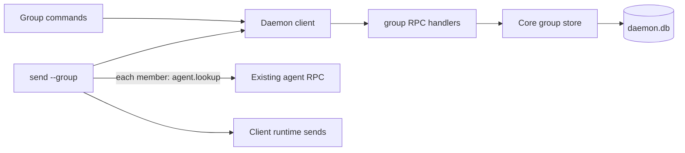

# Agent groups in daemon.db

Status: approved by the user (2026-11-18; updated 2026-11-24 to remove the
unused legacy JSON migration path and align with post-review refinements).
Scope source: issue #413 and the supplied group-daemon brief. Rebased onto
`origin/main` (`7528c760`).

## Architecture Overview

The daemon is the sole owner and writer of group state. Extend `Store`, protocol
types, dispatcher, and `DaemonClient`. Put group persistence in a dedicated core
store module (`devkit-core/src/store/groups.rs`) and wire operations in the
`group.*` RPC namespace (`devkitd/src/rpc/group.rs`). Replace JSON access in CLI
group commands with an asynchronous daemon-backed `AgentGroupService` that calls
the typed `DaemonClient` methods while retaining domain error classes, `--debug`
logging, and command output shapes. Never route groups back to JSON when
connection or capability detection fails.

## Design Decisions

1. **Membership rows.** Use `group_members(group_name, member, position)` with
   primary key `(group_name, member)`, unique `(group_name, position)`, and a
   foreign key to `groups(name)` with `ON DELETE CASCADE`. Enable
   `PRAGMA foreign_keys = ON` on the store connection. Fetch all groups in a
   single `LEFT JOIN` query ordered by `(g.ordinal, m.position)`.
2. **Unavailable when daemon is down.** All seven commands and group lookup
   require a running, capable daemon. Transport failure and unsupported methods
   produce actionable errors without local retries or JSON fallback.
3. **No legacy `agent-groups.json` migration path (2026-11-24).** Because no
   users rely on `agent-groups.json` yet, `devkitd` does not import, fence, or
   unlink legacy JSON files. Group tables are initialized cleanly in
   `Store::open` (`init_groups`) with no `group_migrations` table.

## Data Models

- `groups`: `ordinal INTEGER PRIMARY KEY AUTOINCREMENT` (preserves insertion
  order for listing), `name TEXT NOT NULL UNIQUE`, `created_at TEXT NOT NULL`,
  `updated_at TEXT NOT NULL` (ISO-8601 UTC strings).
- `group_members`: `group_name TEXT NOT NULL REFERENCES groups(name) ON DELETE
  CASCADE`, `member TEXT NOT NULL`, `position INTEGER NOT NULL`,
  `PRIMARY KEY(group_name, member)`, `UNIQUE(group_name, position)`. Members are
  identifiers, not foreign keys to live agent registrations: missing/dead agents
  do not invalidate a group.

All mutations run under the `Store` connection mutex and a transaction. Create,
update, add-member, remove-member, and delete enforce invariants before commit.
No-op add preserves `updatedAt`; successful membership changes update it.
Create/update reject blanks and duplicates after trimming; members do not
inherit the group-name regex. Group names trim and match `AGENT_NAME_REGEX`.
Removing an absent member is `InvalidMember`; removing the final member is
`EmptyMembers`.

## API Design

Use the existing daemon wire envelope and `ts-rs`-generated Rust/TypeScript
protocol types (`AgentGroup`, `GroupNameParams`, `GroupMembersParams`,
`GroupMemberParams`). Group records retain
`{ name, members, createdAt, updatedAt }`.

| RPC | Parameters | Result |
| --- | --- | --- |
| `group.create` | `name`, `members` | `AgentGroup` |
| `group.update` | `name`, `members` | `AgentGroup` with replaced members |
| `group.add` | `name`, `member` | `AgentGroup` |
| `group.remove_agent` | `name`, `member` | `AgentGroup` |
| `group.remove` | `name` | `{ ok: true }` |
| `group.list` | none | `AgentGroup[]` in insertion order |
| `group.detail` | `name` | `AgentGroup` |
| `group.lookup` | `name` | `AgentGroup` with ordered members for fanout |

Distinct coded errors (`not_found`, `conflict`, `invalid_name`,
`invalid_member`, `empty_members`, `storage`) map back to the six CLI
`AgentGroup*Error` classes with structured details. Malformed wire parameter
types return `invalid_params`; unknown `group.*` methods return
`unknown_method`. Connection/capability errors remain availability errors rather
than masquerading as missing groups.

Group send opens one daemon connection, calls `group.lookup`, then calls
`agent.lookup` for each resolved member and delivers via the existing client
`sendAgentPrompt` machinery using `createDaemonEntryRegistry`. Only `not_found`
and `!entry.alive` are collected as per-member resolution errors; transport
failures and `unknown method` abort immediately. Because `agent.lookup` does not
carry live turn status, group delivery does not emit synthetic busy warnings.
Ordinary single-agent send behavior remains outside this migration's scope.

## Validation and Rollout

- Core store tests: CRUD, ordering, normalization, duplicate/blank/empty
  rejection, no-op add, absent/final-member removal, timestamp behavior, atomic
  rollback (SQL trigger fault injection), persistence, and concurrent mutations.
- Daemon integration tests: all eight RPCs, malformed requests, `unknown_method`,
  and coded domain error categories.
- TypeScript tests in `packages/<pkg>/tests/`: typed `DaemonClient` group
  methods, `AgentGroupService` routing/error mapping/availability/`onDebug` and
  caller-owned client reuse, CLI routing of all seven commands (including
  `--debug`), `wait --group`, and `send --group` fanout/error-handling rules.
- E2E in root `e2e/agent-groups.e2e.ts`: built CLI and real `devkitd` with
  disposable homes and dead stub registrations verifying ordered `group.lookup`
  + `agent.lookup` fanout, CRUD, error categories, and persistence across
  restart.
