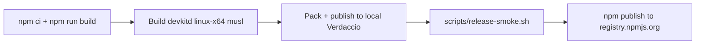

# Design — release smoke CI gate

## Architecture

## Components

### `scripts/release-smoke-pack-registry.sh`

- Builds `devkitd` with `DEVKITD_BUILD_VERSION` from `packages/daemon-client/package.json`.
- Stages `out/devkitd-linux-x64` and a copy of `daemon-client` with optionalDependencies pinned to that version (matches `publish-daemon-client.yml` without mutating the workspace tree).
- Starts ephemeral Verdaccio on `127.0.0.1:4873`.
- Publishes workspace packages in dependency order, then prints `ai-devkit@<cli version>`.
- Writes `registry` and `package_spec` to `$GITHUB_OUTPUT` when set.

### `scripts/release-smoke.sh`

- Honors `AI_DEVKIT_SMOKE_REGISTRY` by setting `npm_config_registry` so `npx -y ai-devkit@<version>` resolves the packed CLI and its pinned workspace dependencies from the local registry.

### `.github/workflows/release-smoke-gate.yml`

Reusable `workflow_call` job: checkout, Node 24, tmux, musl toolchain, Rust musl target, build, pack registry, run smoke.

### Publish workflow integration

- `publish-cli.yml`, `publish-daemon-client.yml`, and `publish-devkitd.yml` add a `release-smoke` job that calls the reusable workflow; publish jobs `needs: release-smoke`.
- `.github/workflows/release-smoke.yml` runs the same gate on PRs (path filter) and `workflow_dispatch`.

## Trade-offs

| Option | Pros | Cons |
|--------|------|------|
| Smoke against npm `@latest` only | Simple | Cannot catch unreleased pin/binary issues |
| Local Verdaccio with packed workspace | Matches what we are about to ship | Longer publish jobs; linux-only devkitd binary in smoke |
| Single orchestrated release workflow | One smoke run per release | Large refactor of all publish workflows |

Chosen: **local Verdaccio + reusable gate** on the three workflows most tied to CLI/daemon releases.

## Platform coverage

Smoke runs on `ubuntu-latest` and installs `@ai-devkit/devkitd-linux-x64` built on that runner. macOS matrix legs in `publish-devkitd.yml` still rely on existing `devkitd version` / `buildVersion` checks; they do not run the full CLI smoke script natively.

## Security

- Local registry is loopback-only and torn down after the job.
- No production credentials beyond existing `NPM_TOKEN` on publish steps (unchanged).