# System Design & Architecture

## Architecture Overview

Mirror the established `capacity/providers` + `capacity/sources` separation in `@ai-devkit/agent-manager`, keeping pure JSON parsing and failure classification decoupled from subprocess execution and filesystem/environment safeguards.

```mermaid
flowchart LR
    CLI["cli: capacityCommand\n(concurrent Promise.allSettled;\nantigravity | agy)"] --> Entry["agent-manager:\ngetAntigravityCapacityReport"]
    Entry --> Source["capacity/sources/antigravity.ts:\nprobeAntigravityCapacity"]
    Source --> Creds["harnesses/antigravity/credentials.ts:\nresolveAntigravityOAuthCredential"]
    Creds -->|token found| Remote["capacity/providers/antigravity.ts:\nfetchAntigravityRemoteCapacity\n(loadCodeAssist -> retrieveUserQuotaSummary)"]
    Remote -->|success| Report["CapacityReport\n(harness: antigravity, provider: antigravity)"]
    Creds -->|no token / expired| Resolve["Resolve agy binary\n(ANTIGRAVITY_CLI_PATH / PATH / well-known)"]
    Remote -->|error / fallback| Resolve
    Resolve --> Version["Check agy --version >= 1.1.11\n(in-process stat cache)"]
    Version --> Runner["Run agy -p /usage --output-format json\n(0700 temp cwd, open/xdg-open stubs,\nAGY_CLI_DISABLE_AUTO_UPDATE=true,\n90s timeout, 1 MiB cap, PGID reap)"]
    Runner -->|stdout JSON| Parser["capacity/providers/antigravity.ts:\nparseAntigravityUsageReport"]
    Runner -->|non-zero exit / error| Classify["capacity/providers/antigravity.ts:\nclassifyAntigravityExitFailure"]
    Parser --> Report
    Classify -->|auth required| Unauth["CapacityReport\n(authenticated: false, available: unknown)"]
    Classify -->|other failure| Err["Sanitized Error\n(never leaks raw stderr)"]
```



## Data Models

### Upstream JSON Response (`agy -p /usage --output-format json`)

```json
{
  "status": "SUCCESS",
  "command": {
    "name": "usage",
    "data": {
      "description": "Models share limits",
      "groups": [
        {
          "name": "Gemini Models",
          "buckets": [
            {
              "id": "gemini-5h",
              "name": "Five Hour Limit Remaining",
              "window": "5h",
              "remaining_fraction": 0.95,
              "reset_time": "2026-09-13T03:48:04Z"
            },
            {
              "id": "gemini-weekly",
              "name": "Weekly Limit Remaining",
              "window": "weekly",
              "remaining_fraction": 0.86,
              "reset_time": "2026-09-17T18:40:27Z"
            }
          ]
        }
      ]
    }
  }
}
```

### Mapping to `ProviderCapacitySnapshot` / `CapacityWindow`

| Upstream Field | Mapped Field / Behavior |
|---|---|
| `status` | Must strictly equal `"SUCCESS"` (otherwise throw parse error) |
| `command.name` | Must strictly equal `"usage"` (otherwise throw parse error) |
| `command.data.groups[]` | Iterated in order; groups with no enabled buckets skipped; group name from `display_name ?? name ?? "Quota"` |
| `bucket.disabled === true` | Skipped (not emitted as a window) |
| `bucket.bucket_id ?? bucket.id` | Required non-empty string; window `id` is `antigravity:${bucketId}` (deduplicated by `id`) |
| `bucket.window` / `display_name` / `name` / `id` | Cadence detection: `5h` / `five_hour` / `5_hour` / `five hour` → `durationMinutes: 300`, short label `"5h"`; `weekly` / `7d` / `1w` / `week` → `durationMinutes: 10080`, short label `"Weekly"`; `daily` / `24h` / `1d` → `durationMinutes: 1440`, short label `"Daily"`; else `durationMinutes: null`, short label `bucketDisplayName` |
| Window `label` | `${groupName} · ${cadenceLabel}` (avoids duplicate cadence suffix if `bucketDisplayName` already includes `groupName`) |
| `remaining_fraction` / `remaining.remaining_fraction` / `remaining.{case:"remainingFraction",value}` | Clamped to `[0, 1]`; `usedPercent = Math.round((1 - clamped) * 1000) / 10` (0–100 with 1 decimal precision); missing → `null` |
| `reset_time` | ISO-8601 string or epoch seconds (number or numeric string) → ISO-8601 `resetsAt`; invalid/missing → `null` |
| `authenticated` | `true` on valid parsed usage report; `false` on classified sign-in/auth failure |
| `available` | `"no"` if at least one measured window exists and **all** measured windows have `usedPercent >= 100`; `"yes"` if at least one measured window has `usedPercent < 100`; `"unknown"` if no windows have a numeric `usedPercent` |
| `creditsRemaining` | `null` (not reported by `agy -p /usage`) |

## API Design

### `packages/agent-manager/src/capacity/providers/antigravity.ts`

```ts
export type AntigravityCliFailureKind =
  | "authentication_required"
  | "executable_not_found"
  | "unsupported_version"
  | "launch_failed"
  | "timed_out"
  | "output_too_large"
  | "network"
  | "eligibility_network"
  | "ineligible"
  | "exited";

export class AntigravityCliError extends Error {
  readonly kind: AntigravityCliFailureKind;
  readonly exitCode?: number;
}

export function parseAntigravityVersion(output: string): [number, number, number] | null;
export function isSupportedAntigravityVersion(version: [number, number, number]): boolean;
export function parseAntigravityUsageReport(raw: unknown): ProviderCapacitySnapshot;
export function classifyAntigravityExitFailure(exitCode: number, stderr: string): AntigravityCliError;
```

### `packages/agent-manager/src/capacity/sources/antigravity.ts`

```ts
export type AntigravityExecResult = {
  exitCode: number | null;
  stdout: string;
  stderr: string;
  timedOut?: boolean;
  outputTooLarge?: boolean;
};

export type AntigravityExecOptions = {
  command: string;
  args: readonly string[];
  cwd: string;
  env: NodeJS.ProcessEnv;
  timeoutMs: number;
  maxOutputBytes: number;
};

export type AntigravityCapacityOptions = {
  now?: () => Date;
  env?: NodeJS.ProcessEnv;
  path?: string;
  access?: (target: string) => Promise<void>;
  stat?: (target: string) => Promise<{ size: number; mtimeMs: number; ino: number }>;
  exec?: (options: AntigravityExecOptions) => Promise<AntigravityExecResult>;
  timeoutMs?: number;
  versionTimeoutMs?: number;
  maxOutputBytes?: number;
};

export type AntigravityProbeOptions = AntigravityCapacityOptions & {
  checkedAt: string;
};

export function resetAntigravityVersionCache(): void;
export function probeAntigravityCapacity(options: AntigravityProbeOptions): Promise<CapacityReport>;
```

### Public Exports & CLI Wiring

- `packages/agent-manager/src/capacity/index.ts`: export `getAntigravityCapacityReport` and `type AntigravityCapacityOptions`.
- `packages/agent-manager/src/index.ts`: re-export `getAntigravityCapacityReport`.
- `packages/cli/src/commands/capacity.ts`: add `"antigravity"` to `SUPPORTED_PROVIDERS`, dispatch `"antigravity"` → `getAntigravityCapacityReport()`, normalize `"agy"` → `"antigravity"`.
- `packages/cli/src/commands/capacity/render.ts`: add `antigravity: "Antigravity"` to `PROVIDER_LABELS`.

## Component Breakdown

1. **Pure Provider Module (`capacity/providers/antigravity.ts`)**:
   - Semver parser (`parseAntigravityVersion`) extracting `major.minor.patch` from strings like `agy 1.2.11` or `antigravity-cli v1.1.11-beta.1` and checking `>= 1.1.11`.
   - Strict-but-tolerant JSON parser (`parseAntigravityUsageReport`) supporting both snake_case and camelCase keys, nested `remaining.remaining_fraction`, oneof `remaining.{case, value}`, epoch-seconds or ISO-8601 `reset_time`, disabled bucket filtering, and truthful availability derivation.
   - Sanitized exit-failure classifier (`classifyAntigravityExitFailure`) matching sign-in, eligibility, and network markers on lowercased stderr and returning fixed safe messages without echoing stderr.
2. **Source Runner (`capacity/sources/antigravity.ts`)**:
   - Binary resolution: if `ANTIGRAVITY_CLI_PATH` is defined in `env`, treat as authoritative (trim; empty/missing/non-executable throws `executable_not_found`, never falls back to `PATH`). Otherwise search `PATH` entries, then `~/.local/bin/agy`, `/opt/homebrew/bin/agy`, `/usr/local/bin/agy`.
   - In-process version cache: caches the most recently checked binary's `{ path, size, mtimeMs, ino, version }` only when `version` parsed cleanly. Unknown/failed version checks are not cached.
   - Safeguarded execution environment:
     - Creates a private `0700` temp directory via `mkdtemp` + `chmod(dir, 0o700)`.
     - Writes `0700` executable stub scripts `open` and `xdg-open` (`#!/bin/sh\nexit 1\n`) inside the temp directory.
     - Builds child `env` with `AGY_CLI_DISABLE_AUTO_UPDATE="true"`, `PATH="${tempDir}:${existingPath}"`, and `BROWSER="${tempDir}/open"`.
     - Spawns `agy` with `detached: true` (on POSIX) so timeout/cap/completion can reap the full process group (`process.kill(-pid, "SIGTERM")`, escalating to `SIGKILL` if needed).
     - Enforces `timeoutMs` (default `90_000` for usage, `3_000` for `--version`) and `maxOutputBytes` (default `1_048_576` = 1 MiB) on stdout/stderr.
     - Always cleans up the temp directory in `finally`.
3. **CLI Integration (`packages/cli/src/commands/capacity.ts`, `render.ts`)**:
   - Minimal additive wiring; preserves existing output for all other providers.

## Design Decisions

1. **Pure provider + testable source split**: Injecting `exec`, `access`, `stat`, and `env` into `probeAntigravityCapacity` allows deterministic unit/integration tests for every safeguard (env vars, stubs, temp dir permissions/cleanup, version caching, timeout/cap) without invoking a real `agy` binary.
2. **Process-group reaping (`detached: true`)**: Matches CodexBar's safety requirement to reap descendant processes (including MCP servers spawned by `agy`) on completion, timeout, or output-cap overflow.
3. **Sanitized error taxonomy**: `classifyAntigravityExitFailure` maps raw stderr into fixed messages so account emails, profile URLs, proxies, or paths can never leak into `ai-devkit capacity` output.
4. **No fabricated 5h windows & truthful availability**: Starter weekly-only responses emit only weekly windows; `available` is `"no"` only when all measured enabled windows are exhausted (`>= 100%`), `"yes"` if any measured window has remaining capacity, and `"unknown"` if none are measured.
5. **Version cache single owner**: Owned exclusively by `capacity/sources/antigravity.ts`, keyed on `(path, size, mtimeMs, ino)` with `resetAntigravityVersionCache()` exported for test isolation.

## Non-Functional Requirements

- **Security**: `0700` temp dir & stubs; no browser OAuth launch on silent auth failure; `AGY_CLI_DISABLE_AUTO_UPDATE=true`; no raw stderr leakage.
- **Performance**: Version check cached across calls in the same process for unchanged binaries; version check bounded to 3s, print usage bounded to 90s (`--print-timeout 90s`) and 1 MiB output.
- **Reliability**: Temp directory and child process group always cleaned up on success, failure, timeout, or output overflow.
- **Dependencies**: Zero new runtime dependencies.
