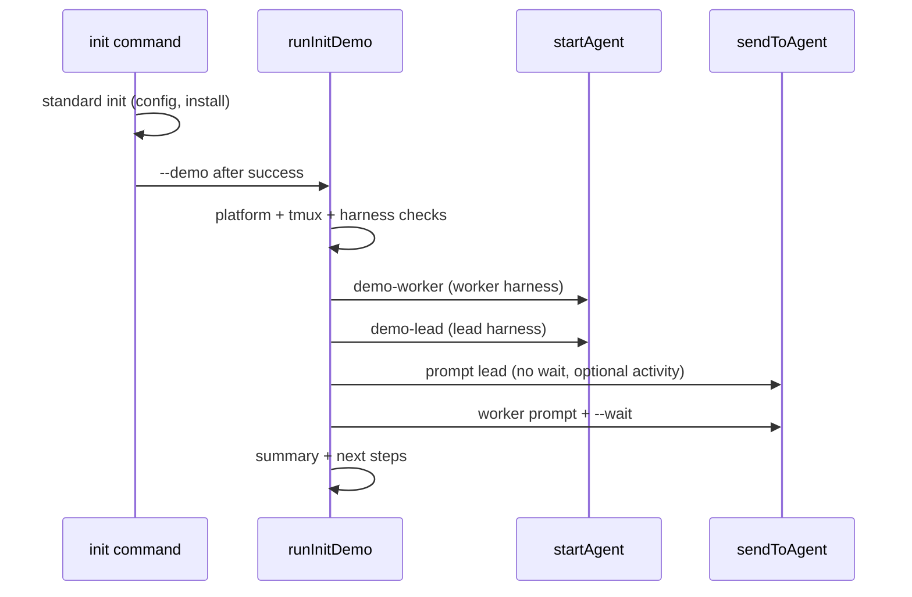

# init --demo Design

## Architecture



`runInitDemo` lives in `packages/cli/src/services/init/init-demo.service.ts` and is invoked from `initCommand` when `options.demo` is set and init finished with exit code 0.

## Harness Selection

```ts
const DEMO_HARNESS_PREFERENCE: StartableAgentType[] = [
  "claude",
  "codex",
  "opencode",
  // remaining StartableAgentType values in stable order
];
```

`listInstalledHarnessTypes` filters preference (and any remaining profile keys) using `commandExistsOnPath(profile.command)`. `pickDemoHarnessPair` returns the first two entries or null when fewer than two are installed.

## Scripted Handoff

Constants:

- `demo-lead` / `demo-worker` agent names.
- Worker prompt: `Reply with exactly: devkit-demo-ok`.
- Lead prompt (no wait): short role line so the lead tmux pane shows activity.
- Summary attributes the worker question to the lead agent for readability.

The worker reply is obtained through the real `sendToAgent` wait path (same as `agent send --wait`). Live harnesses may paraphrase; CI uses mocks. Manual validation on a Mac with claude + codex is the acceptance bar for the happy path.

## Platform and tmux

| Platform | Behavior |
|----------|----------|
| `win32` | Error message, exit 1, no agent start |
| `darwin` / `linux` | Continue |
| other Unix | Treated like Linux for tmux hints |

Missing tmux uses `resolveTmuxInstallInstructions(createTmuxInspectionDeps())` like `agent start`.

## Cleanup vs UX

Existing `agent start` leaves sessions running and prints `tmux attach -t <session>`. The demo **does not** kill agents afterward: users can attach and explore. Summary includes attach guidance via the same fields `startAgent` already returns. Rationale: killing immediately would contradict console-first workflows and the demo’s purpose as a starting point.

## CLI Wiring

- `main.ts`: `.option("--demo", ...)`.
- `init.ts`: `demo?: boolean` on options; call `runInitDemo({ cwd: process.cwd() })` after successful init.

## Testing

| Layer | Location | Focus |
|-------|----------|--------|
| Unit | `packages/cli/tests/services/init/init-demo.test.ts` | harness pick, error messages, orchestration with injected deps |
| E2E | `e2e/init-demo.e2e.ts` | `runInitDemo` failure paths via compiled export |

## Error Messages

- **Windows**: plain language that demo is macOS/Linux only.
- **No tmux**: reuse install instructions string from tmux helper.
- **One harness**: list detected type(s) and suggest installing another CLI on PATH (claude, codex, or opencode called out as examples).

## Next Steps Copy

After success, print exactly three suggestions:

1. `ai-devkit agent list`
2. `ai-devkit agent console`
3. `ai-devkit status`