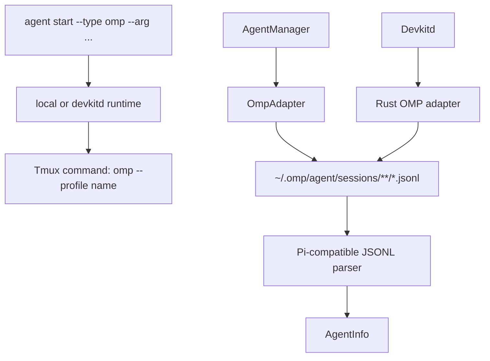

# Design: OMP Agent Harness Support

## Architecture Overview



OMP uses the Pi-compatible JSONL message envelope but has an independent storage root and project-directory encoding. The adapter reuses the existing parser/matching primitives where their contracts fit, while keeping `type: "omp"` and OMP paths explicit.

## Data Model

- Add `"omp"` to `AGENT_TYPES` and `AgentType`.
- OMP session root: `~/.omp/agent/sessions` by default.
- OMP project bucket: the observed form is `-<cwd relative to $HOME, separators replaced by ->` (for example with `$HOME=/home/me`, `/home/me/repo` → `-repo`). Matching compares encoded live CWD values; it does not lossy-decode bucket names.
- `AgentInfo.type` is `"omp"`; `sessionFilePath` points to the JSONL file; `sessionId`, project path, summary, status, and timestamps follow the shared Pi-compatible record semantics.

## TypeScript Components

- `OmpAdapter`: precise OMP process matching, live session matching, process-only fallback, historical listing, and conversation access.
- Reuse `PiSessionLocator` with injected OMP root/encoder and reuse the Pi parser; this avoids duplicating schema and incremental-scan logic while keeping OMP paths explicit.
- `runtimeProfiles.ts`: add the OMP command, runtime kind, discovery aliases, and Bun/CLI matcher.
- `ManagedAgentRuntime`: pass structured args to the runtime and compose a quoted Tmux command.
- CLI: add repeatable `--arg <value>` and forward it through daemon and local paths.

## Rust Components

- `devkit-harness::omp`: mirror process matching, session root, locator, parser mapping, and process-only fallback.
- Register OMP in `default_registry`.
- Add an OMP `StartProfile` with a matcher that recognizes the OMP Bun CLI path.
- `devkitd` Tmux runtime composes profile command plus validated argv arguments using the same deterministic shell quoting contract as TypeScript.

## Profile Launch Contract

An alias such as:

```bash
alias omp-work='omp --profile work'
```

is represented as:

```text
--type omp --arg --profile --arg work
```

AI DevKit MUST NOT invoke `bash -ic` or evaluate alias text. This avoids dependence on interactive shell startup files and avoids arbitrary shell injection through the vendor configuration.

## Matching Contract

- Accept the direct `omp` executable.
- Accept Bun commands whose argv contains the OMP CLI entry path and `omp`/`pi-coding-agent` package marker.
- Reject unrelated `bun`, `node`, and arbitrary scripts.
- Start-profile matching and discovery matching use the same OMP identity rule.

## Design Decisions

- OMP is a first-class built-in type, not a generic arbitrary-vendor registry.
- Structured arguments are additive and generic enough for OMP profiles; shell aliases are documentation-only conveniences.
- Durable mode is explicitly excluded until OMP print/resume semantics are verified.
- The Rust daemon mirrors the TypeScript adapter because daemon results suppress local adapter discovery when non-empty.

## Security and Performance

- Session files are read only below the configured/default OMP root.
- JSONL parsing skips malformed records and bounds head reads using existing utilities.
- Tmux arguments are quoted as argv values; no user-provided shell fragment is evaluated.
- Discovery remains bounded to OMP `*.jsonl` files and uses existing incremental summaries.
